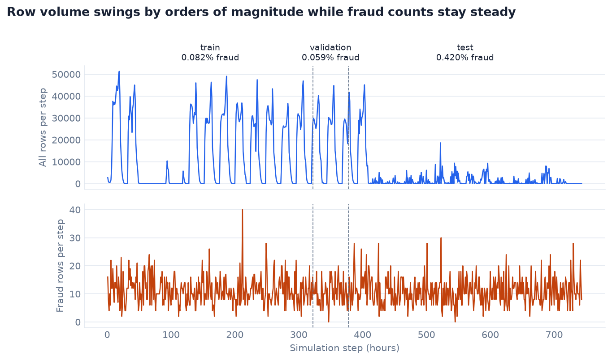
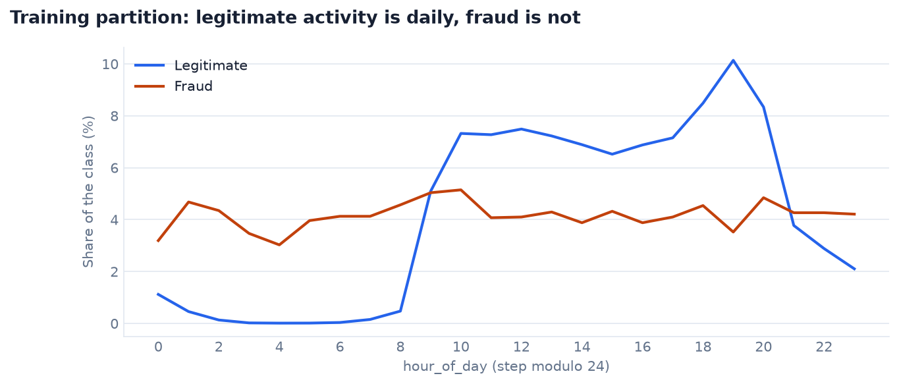
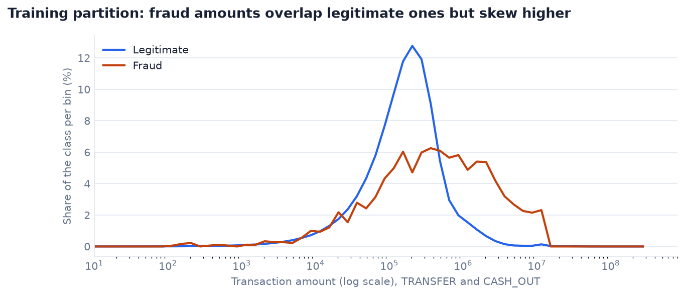
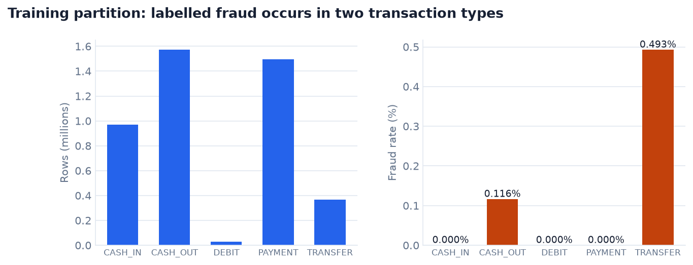

# Dataset Documentation

All figures here come from committed pipeline outputs: [dataset_validation.json](experiments/results/dataset_validation.json), [eda_summary.json](experiments/results/eda_summary.json), [leakage_audit.json](experiments/results/leakage_audit.json) and [preprocessing_v1.json](artifacts/metadata/preprocessing_v1.json).

## Source

**PaySim: Synthetic Financial Datasets for Fraud Detection**, from <https://www.kaggle.com/datasets/ealaxi/paysim1>.

Citation: E. A. Lopez-Rojas, A. Elmir and S. Axelsson, "PaySim: A financial mobile money simulator for fraud detection", EMSS 2016. The Kaggle page lists the licence as CC BY-SA 4.0; confirm it there before redistributing any data.

**It is simulated data.** Every pattern below describes the simulator, and results here say nothing about real-world fraud rates or real customers.

The file is not stored in Git (about 494 MB).

### Getting the file

1. Download the CSV from the Kaggle page, then:
   ```powershell
   uv run --project backend python scripts/download_dataset.py --from-file <path to downloaded csv>
   ```
2. Or, with the Kaggle CLI and your own API token configured, omit `--from-file`. This route has not been exercised on the development machine.

## Verified file identity

| Property | Value |
|---|---|
| File | `PS_20174392719_1491204439457_log.csv` |
| Size | 493,534,783 bytes |
| SHA-256 | `16910f90577b0d981bf8ff289714510bb89bc71bff7d3f220f024e287e4eea6b` |
| Rows | 6,362,620 |
| Columns | 11 |
| Steps | 1 to 743, all present, sorted (about 31 days at one hour per step) |
| Missing values | 0 |
| Duplicate rows | 0 |
| Fraud rows | 8,213 (0.1291%) |

## Data dictionary

| Column | Type | Description | Pipeline use |
|---|---|---|---|
| `step` | integer | Simulation hour | Source of hour features; stored for evaluation windows; not itself a feature |
| `type` | text | Transaction category | Feature `transaction_type` |
| `amount` | decimal | Transaction amount | Features `amount`, `amount_log1p` |
| `nameOrig` | text | Origin account ID | Never read |
| `oldbalanceOrg` | decimal | Origin balance before | Never read by the pipeline; audit only |
| `newbalanceOrig` | decimal | Origin balance after | Never read by the pipeline; audit only |
| `nameDest` | text | Destination account ID | Only its first letter is used |
| `oldbalanceDest` | decimal | Destination balance before | Never read by the pipeline; audit only |
| `newbalanceDest` | decimal | Destination balance after | Never read by the pipeline; audit only |
| `isFraud` | 0 or 1 | Simulator's fraud label | Target, stored separately as `is_fraud` |
| `isFlaggedFraud` | 0 or 1 | Output of an existing rule | Baseline only, stored separately as `is_flagged_fraud` |

## Distribution across the whole file

| Type | Rows | Fraud rows | Destination prefix |
|---|---:|---:|---|
| CASH_IN | 1,399,284 | 0 | C |
| CASH_OUT | 2,237,500 | 4,116 | C |
| DEBIT | 41,432 | 0 | C |
| PAYMENT | 2,151,495 | 0 | M |
| TRANSFER | 532,909 | 4,097 | C |

- **Fraud occurs only in CASH_OUT and TRANSFER.**
- **Destination category adds no information:** merchant destinations occur if and only if the type is PAYMENT.
- **Existing rule:** flags 16 rows, all fraud, so it has 100% precision and catches 0.19% of fraud.
- **Amount:** none negative; maximum 92,445,516.64.

## Data quality findings

| Finding | Count | Handling |
|---|---:|---|
| Amount exactly 0 | 16, all labelled fraud | Retained and reported as a validation warning. No record is altered or removed. |

There is no separate cleaning stage that changes rows, because validation found nothing that needed changing. "Cleaning" in this pipeline consists of typing columns and mapping the destination prefix to a category.

## Feature dictionary

Machine-readable version: [feature_dictionary_v1.json](artifacts/metadata/feature_dictionary_v1.json). Schema version `1.0.0`.

| Feature | Source | Transformation | Type | Business meaning | Available before completion |
|---|---|---|---|---|---|
| `amount` | `amount` | Unchanged | float64 | Value of the transaction | Yes |
| `amount_log1p` | `amount` | natural log of (1 + amount) | float64 | Order of magnitude; compresses heavy skew for linear models | Yes |
| `transaction_type` | `type` | Fixed five categories | category | Kind of movement | Yes |
| `destination_category` | `nameDest` | First letter: C is customer, M is merchant | category | Who receives the money. Required by the PRD; redundant with type here | Yes |
| `hour_of_day` | `step` | step modulo 24 | int64 | Simulated hour of day | Yes |
| `hour_sin` | `step` | sin(2 pi hour / 24) | float64 | Clock position, keeping 23:00 next to 00:00 | Yes |
| `hour_cos` | `step` | cos(2 pi hour / 24) | float64 | Clock position, second component | Yes |

The hour's clock phase is an assumption: PaySim defines a step as one hour but not which time step 1 represents.

### Rejected features

| Candidate | Reason |
|---|---|
| The four balance columns | Affected by the simulator's fraud cancellation, and post-transaction values do not exist at assessment time |
| `isFlaggedFraud` | Output of an existing rule; used as a separate baseline |
| `step`, day index | Unbounded, so later partitions fall outside the training range, and trees could memorise time periods |
| Account IDs as numbers | Identifiers have no numeric meaning |
| Account transaction counts | Need identifiers and online history, which the prediction input lacks. Training on them would create skew |
| Exactly 10M amount, round amount | Encode the simulator's fraud amount cap rather than transferable behaviour |

## Leakage audit

`scripts/audit_leakage.py` runs three checks. The schema and file checks passed.

**Separation** below is a single column's ROC-AUC with direction removed: 0.5 means no separation and 1.0 means perfect. All values are measured on **training rows only**.

| Excluded column | Separation |
|---|---:|
| Derived origin balance error (`old - amount - new`) | 0.919 |
| `oldbalanceOrg` | 0.803 |
| `newbalanceOrig` | 0.709 |
| `oldbalanceDest` | 0.633 |
| Derived destination balance error | 0.552 |
| `newbalanceDest` | 0.542 |

| Balance behaviour | Fraud rows | Legitimate rows |
|---|---:|---:|
| Origin balance reconciles exactly after the transaction | 99.1% | 20.3% |
| New origin balance is zero | 98.7% | 56.5% |
| Destination balance unchanged | 49.1% | 36.3% |

The reconciliation gap shows why these columns are excluded. It reflects the simulator's bookkeeping after the event, which a real system could not observe when assessing a request.

| Selected feature | Separation |
|---|---:|
| `transaction_type` | 0.849 |
| `amount`, `amount_log1p` | 0.783 |
| `hour_sin` | 0.674 |
| `destination_category` | 0.669 |
| `hour_of_day` | 0.649 |
| `hour_cos` | 0.632 |

These are single-column figures and do not predict combined model performance. High separation for `transaction_type` is not leakage: type is known at request time.

## Chronological partitions

Config: [split_v1.json](experiments/experiment-configs/split_v1.json). Boundaries use row counts only, and a step is never divided.

| Partition | Steps | Rows | Fraud rows | Fraud rate | Rule-flagged rows |
|---|---|---:|---:|---:|---:|
| Train | 1 to 322 | 4,433,703 | 3,633 | 0.0819% | 3 |
| Validation | 323 to 377 | 973,173 | 570 | 0.0586% | 0 |
| Test | 378 to 743 | 955,744 | 4,010 | 0.4196% | 13 |

## EDA findings

Charts are in [experiments/figures/eda/](experiments/figures/eda/).

### Row volume swings while fraud stays steady


Fraud stays near 11 rows per step throughout. Row volume does not: it has a near-empty stretch around steps 50 to 125 and collapses after about step 400. Across the partitions, steps with fewer than 1,000 rows behave very differently from the rest:

| Partition | Low-volume steps | Their rows | Their fraud rows | Fraud rate within them | Share of partition's fraud |
|---|---:|---:|---:|---:|---:|
| Train | 139 of 322 | 9,957 | 1,486 | 14.9% | 40.9% |
| Validation | 15 of 55 | 1,479 | 160 | 10.8% | 28.1% |
| Test | 246 of 366 | 25,746 | 2,812 | 10.9% | 70.1% |

### Fraud has no daily cycle (training rows)


Legitimate activity concentrates between hours 9 and 20. Fraud is roughly flat, so overnight transactions are far more likely to be fraud.

### Fraud amounts skew higher but overlap (training rows)


Within TRANSFER and CASH_OUT, the two classes overlap heavily up to a few hundred thousand. Fraud has a much longer upper tail, ending at the simulator's 10,000,000 cap (84 fraud and 2,113 legitimate rows sit exactly at the cap in training). Whole-number amounts make up 6.3% of fraud against 1.1% of legitimate rows.

### Two transaction types (training rows)


TRANSFER has a fraud rate of 0.493% and CASH_OUT 0.116%, though CASH_OUT has about four times the rows.

## Reproducing all of this

See [ENVIRONMENT_SETUP.md](ENVIRONMENT_SETUP.md). Rerunning `scripts/prepare_dataset.py` was verified to produce byte-identical metadata.
